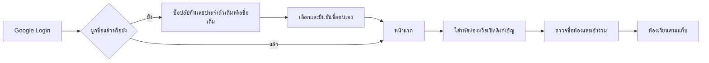

# ห้องเคมี — แบบประสบการณ์ใช้งานฉบับที่ 1

อัปเดต 30 กันยายน 2026 · อ้างอิง `SYSTEM_SPEC.md` หลังยืนยัน I1–I5, J1–J10, K1–K6, L1–L6, N1–N4 และแผน A · ปรับสีและฟอนต์ตามแบบหน้าจอฉบับที่ 2 และปรับแบบหน้าจอตามรอบ K/L แล้ว
เอกสารนี้เป็นแบบสำหรับตรวจร่วมกัน ยังไม่ใช่แอปที่พัฒนาแล้วหรือผลทดสอบระบบจริง

## 1. สถานะและหลักการออกแบบ

- **[ยืนยัน]** ครูเคมี 1 คน นักเรียน ม.5 ประมาณ 125 คนใน 3 ห้อง เริ่มทดลองหนึ่งห้องก่อน
- **[ยืนยัน]** ชื่อชั่วคราว “ห้องเคมี” พื้นครีม สีหลักม่วง หน้างานคลีน ส่วนสุ่มและตู้สะสมมีแฟนตาซี
- **[ยืนยัน 28 ก.ย. 2026]** แนวภาพ “อบอุ่น นุ่มนวล” และชุดสีกับฟอนต์ในส่วน 13 ตามแบบหน้าจอฉบับที่ 2 `exports/chemistry-design-v2.html` แบบนี้มีหน้าจอนักเรียน S01–S05 และ C01 หน้าเข้าสู่ระบบ A01–A02 หน้าบัญชี S06 หน้าครู T01–T12 หน้าต่าง M1–M3 และหน้าดูแลระบบ D01 ด้วยข้อมูลตัวอย่าง; ตำแหน่ง ปุ่ม และข้อความในแบบยังเป็นข้อเสนอตามข้อถัดไป
- **[ยืนยัน]** นักเรียนใช้มือถือ/แท็บเล็ตเป็นหลัก ครูตรวจบนคอมพิวเตอร์ และทุกบทบาทใช้จอขนาดอื่นได้
- **[ข้อเสนอ]** รายละเอียดหน้าจอ ตำแหน่ง ปุ่ม ข้อความ และจุดเปลี่ยนขนาดจอในเอกสารนี้เป็นข้อเสนอ เว้นแต่ติดป้ายยืนยัน; ป้าย **[ยืนยัน …]** ยืนยัน **กติกา** ในบรรทัดนั้น ส่วนถ้อยคำในเครื่องหมายคำพูด ตำแหน่ง และหน้าตาที่เขียนประกอบยังเป็นข้อเสนอที่ปรับได้ตอนพัฒนา เว้นแต่ระบุว่าเป็นกติกา
- แสดงงานที่ต้องทำก่อนกิจกรรมสะสม; เปิดรายละเอียดเดียวแล้วเข้าถึงโจทย์ งานส่ง ผลตรวจ ความคิดเห็น และเฉลย
- แยกสถานะการส่ง ผลตรวจ และรางวัล ไม่ใช้คำว่า “ผ่าน” แทนทั้งสามเรื่อง
- ทุกหน้าที่บันทึกข้อมูลต้องมีสถานะกำลังทำงาน สำเร็จ และผิดพลาดที่บอกวิธีทำต่อ โดยไม่ทำให้ผู้ใช้กดซ้ำ

## 2. โครงสร้างหน้าและสิทธิ์

| บทบาท | เมนูหลักที่เสนอ | เห็นและทำได้ |
| --- | --- | --- |
| นักเรียน | ชั้นเรียนของฉัน; ยอดโทเคนเล็กที่หัวเว็บ; กระดิ่ง; บัญชี | งานในห้องที่เข้าร่วม งานส่ง/คะแนน/บทสนทนาของตน สุ่มและตู้สะสมของตน |
| ครู | ชั้นเรียน; รายชื่อนักเรียน; เครื่องราง; ภาคเรียน; กระดิ่ง | สร้างโพสต์ ตรวจงาน ตารางคะแนน นำเข้า Excel แก้การผูกบัญชี ปรับโทเคน |
| ผู้พัฒนา/ผู้ดูแล | หน้าดูแลระบบ (D01) แยกจากเมนูการเรียน | ชุดสำรองและทดสอบกู้คืน; **[ยืนยัน 29 ก.ย. 2026]** กำหนดบัญชีครู และแก้ข้อมูลแทนครูได้ผ่านโหมดผู้ดูแล |

- **[ยืนยัน]** ภายในห้องใช้สามแท็บตรงตัว: **โพสต์ทั่วไป / โพสต์งานของคุณครู / สมาชิก**
- เครื่องมือของครู เช่น ตารางคะแนนและตั้งค่างาน เป็นปุ่มในบริบทห้อง ไม่เพิ่มแท็บหลักห้องชื่อใหม่
- **[ยืนยัน 29 ก.ย. 2026]** บัญชีครูกำหนดล่วงหน้าโดยผู้ดูแล ไม่มีปุ่มสมัครหรือเลือกบทบาทเป็นครู
- รายชื่อสมาชิกแสดงเฉพาะห้องที่ตนเข้าร่วม; ไม่เชื่อมไปดูงานส่ง คะแนน หรือทั้งตู้สะสมของเพื่อน

## 3. รายการหน้าจอ

| รหัส | หน้าหรือหน้าต่าง | งานหลักและปลายทาง |
| --- | --- | --- |
| A01 | เข้าใช้งาน | Google Login → A02 สำหรับนักเรียนยังไม่ผูกชื่อ; ผูกแล้วไป S01; ครู/ผู้ดูแลไปหน้าหลักตามบทบาท; มีแบบมาจากลิงก์เชิญและแบบเข้าไม่สำเร็จ |
| A02 | ป๊อปอัปเลือกชื่อ | ค้นด้วยเลขประจำตัวเต็มหรือชื่อ-นามสกุลเต็ม (L3) → ยืนยันว่าเป็นฉัน → S01 แบบยังไม่มีห้อง พร้อมช่องเข้าชั้นเรียน |
| S01 | ชั้นเรียนของฉัน | ห้องที่เข้าร่วมและงานใกล้ส่ง → S02; ปุ่มเข้าชั้นเรียน |
| S02 | ห้องเรียน | สามแท็บตามชื่อยืนยัน → งาน S03 หรือรายชื่อสมาชิก |
| S03 | รายละเอียดงาน | โจทย์ แนบ/ส่งไฟล์ ผลตรวจ ความคิดเห็น เฉลย |
| S04 | สุ่มเครื่องราง | ยอดปัจจุบัน อัตราสุ่มที่ใช้ ปุ่มสุ่ม ผลที่ได้ → S05 |
| S05 | ตู้สะสมของฉัน | กดเครื่องรางที่มีแล้ว → ป๊อปอัปคำอธิบาย วันที่ได้รับ และปุ่มแสดงเครื่องรางนี้ข้างชื่อ |
| C01 | กระดิ่ง | รายการยังไม่อ่าน → งาน/ประกาศที่เกี่ยวข้อง |
| S06 | บัญชีของฉัน | ชื่อ เลขที่ เลขประจำตัวจากรายชื่อครู (แก้เองไม่ได้) ยอดโทเคน ตู้สะสม ชั้นเรียน บัญชี Google และออกจากระบบ |
| T01 | หน้ารวมห้องครู | ทุกชั้นเรียนและยอดงานรอตรวจ → T08; สร้างชั้นเรียน → T09; ไม่แสดงรหัสชั้นเรียนในหน้านี้ |
| T02 | สร้าง/แก้โพสต์ | งานหรือประกาศในห้องนั้น → เผยแพร่กลับ T08 (นักเรียนเห็นใน S02); โหมดแก้ไขเปิดจากการ์ดโจทย์ใน T03 (N2) |
| T03 | รายการส่งงานและหน้าตรวจ | การ์ด “โจทย์และไฟล์” (แก้ไขงาน · ลบงาน · พับได้) → เลือกนักเรียน → ดูไฟล์คู่กับผลตรวจ/ความคิดเห็น |
| T04 | ตารางคะแนน | เลือกห้อง/เทอม ตรวจคะแนน → ส่งออก CSV |
| T05 | รายชื่อและบัญชี | นำเข้า Excel ตรวจรายการ แก้การผูกบัญชี; เข้าปรับโทเคนรายคน |
| T06 | จัดการเครื่องราง | รูป ชื่อ คำอธิบาย ระดับ และอัตราสุ่ม |
| T07 | ภาคเรียนและข้อมูลเก่า | เริ่มเทอมใหม่ หรือจบภาคเรียนโดยไม่เปิดเทอมใหม่ ดูกำหนดเก็บข้อมูล ดาวน์โหลดและยืนยันลบ ลบไฟล์เทอมเก่าก่อนครบ 60 วันหลังดาวน์โหลด |
| T08 | ห้องเรียนของครู | สามแท็บเดียวกับ S02 · รายการงานทั้งหมดพร้อมยอดส่ง/รอตรวจ → T03; สร้างงานหรือประกาศ → T02; ทางลัดตารางคะแนน T04 และรายชื่อ T05; กดรหัสชั้นเรียน → T10; ปิด/เปิดการเข้าห้อง |
| T09 | สร้างชั้นเรียน | ชื่อชั้นเรียน รายละเอียดไม่บังคับ ภาคเรียนปัจจุบัน → ระบบสร้างรหัสแล้วพาไป T08 ซึ่งแสดงรหัสที่แถบบน |
| T10 | รหัสชั้นเรียนเต็มจอ | ชื่อห้อง รหัสตัวใหญ่ และสามขั้นตอนเข้าห้อง ปุ่มคัดลอกรหัสและปิด (Esc ก็ปิดได้) |
| T11 | แจ้งเตือนของครู | งานรอตรวจรวมตามงาน/ห้อง → T03 หน้าสถานะการส่งของงานนั้น; ความคิดเห็นจากนักเรียนแยกรายคน → T03 หน้าตรวจของนักเรียนคนนั้น (เปิดได้แม้ยังไม่ส่ง เพื่อตอบความคิดเห็น); พื้นที่เก็บไฟล์ → T07 |
| T12 | บัญชีครู | ชื่อ บัญชี Google ชั้นเรียนที่ดูแล และออกจากระบบ |
| M1–M3 | หน้าต่างย่อยจาก T03 | เปลี่ยนกำหนดส่ง (เร็วขึ้น/ช้าลง, N3) · ปิดรับงาน (ทันที/ตั้งเวลา) · เตรียมและเผยแพร่เฉลย; หน้าต่างยืนยันลบงาน/ประกาศ (N4) |
| D01 | หน้าดูแลระบบ | สำรองล่าสุด จุดกู้คืน 7 วันพร้อมผลทดสอบกู้คืนล่าสุด พื้นที่เก็บไฟล์พร้อมเกณฑ์เตือน บัญชีครูที่อนุญาต และปุ่มเข้าหน้าครูในโหมดผู้ดูแล (L6) |

## 4. เข้าระบบและเข้าห้องของนักเรียน

- **[ยืนยัน]** ใช้ Google ได้ทั้งบัญชีส่วนตัวและโรงเรียน; การเลือกชื่อไม่ทำให้เข้าห้องอัตโนมัติ
- **[ยืนยัน]** เข้าห้องด้วยรหัสร่วม/ลิงก์ ไม่ใช้รหัสรายคนและไม่ต้องรออนุมัติสมาชิก
- **[ยืนยัน 28 ก.ย. 2026]** รหัสมาจากการที่ครูสร้างชั้นเรียน (T09) ระบบสร้างให้อัตโนมัติ แสดงเฉพาะในหน้าชั้นเรียน (T08) ไม่แสดงบนหน้าภาพรวมหรือหน้ารายชื่อนักเรียน ครูกดที่รหัสเพื่อแสดงเต็มจอได้ (T10) และกด “ปิดการเข้าห้อง” ได้
- **[ข้อเสนอ]** ปุ่ม “เข้าชั้นเรียน” บน S01 เปิดช่องใส่รหัส แปลงเป็นตัวพิมพ์ใหญ่ให้เอง → “ค้นหา” → แสดงชื่อห้อง ครู และจำนวนสมาชิกให้ตรวจ → “เข้าร่วมชั้นเรียนนี้”; รหัสผิดแสดง “ไม่พบชั้นเรียนจากรหัสนี้ ตรวจตัวอักษรอีกครั้ง หรือถามคุณครู”; ถ้าอยู่แล้วแสดง “คุณอยู่ในชั้นเรียนนี้แล้ว”
- **[ข้อเสนอ]** A01 เป็นหน้าเดียวสำหรับทุกบทบาท: แถบม่วงพร้อมโลโก้และชื่อเว็บ ปุ่ม “เข้าสู่ระบบด้วยบัญชี Google” (ของจริงให้ใช้ปุ่มตามแนวทางของ Google) บอกว่าใช้ได้ทั้งบัญชีส่วนตัวและโรงเรียน และสามขั้นตอนเริ่มใช้; ถ้ามาจากลิงก์เชิญ บอกชื่อห้องก่อนเข้าสู่ระบบ; ถ้าเข้าไม่สำเร็จ บอกว่าบัญชีโรงเรียนอาจไม่อนุญาตเว็บภายนอก ให้ลองบัญชีส่วนตัวหรือแจ้งครู
- **[ยืนยัน L3]** A02 ค้นได้เฉพาะ **เลขประจำตัวเต็ม หรือชื่อ-นามสกุลเต็ม** ไม่ค้นทีละตัวอักษร ผลแสดงเฉพาะรายชื่อที่ยังไม่ผูก เป็นชื่อแบบปิดบางส่วน ห้อง และเลขที่ และจำกัดจำนวนครั้งค้น/ยืนยันต่อบัญชี; **[ข้อเสนอหน้าจอ]** แผ่นเลื่อนขึ้นที่ปิดไม่ได้จนเลือกเสร็จ บอกบัญชีที่ล็อกอินอยู่พร้อมลิงก์ “เปลี่ยนบัญชี” ช่องเดียว “เลขประจำตัว หรือ ชื่อ นามสกุล (พิมพ์ให้ครบ)” กับปุ่ม “ค้นหา” (ไม่ค้นระหว่างพิมพ์) ผลเป็นการ์ดเช่น “ธน•••• ใจ•• · ม.5/1 เลขที่ 12”; ถ้าตรงกับรายชื่อที่ผูกแล้วไม่แสดงชื่อ แต่บอก “รายชื่อนี้เชื่อมกับบัญชีแล้ว ให้คุณครูช่วยตรวจสอบ”; เหลือจำนวนครั้งค้นน้อยให้บอกล่วงหน้า และเกินเพดานบอก “ค้นหลายครั้งเกินไป รอสักครู่แล้วลองใหม่ หรือติดต่อคุณครู”; ขั้นที่ 2 ย้ำว่าเลือกได้ครั้งเดียว
- เลือกแล้วแสดงชื่อแบบปิดบางส่วน ห้อง และเลขที่ให้ตรวจในป๊อปอัปเดิม ปุ่ม “ยืนยันว่าเป็นฉัน”; ยังไม่ปิดหน้าต่างจนผูกสำเร็จ และแสดงชื่อเต็มหลังผูกสำเร็จแล้วเท่านั้น
- ไม่พบชื่อ: “ไม่พบรายชื่อ ตรวจว่าพิมพ์เลขประจำตัวหรือชื่อ-นามสกุลครบและถูกต้อง หรือติดต่อคุณครู”; ไม่เปิดสมัครรายชื่อใหม่เอง
- ชื่อถูกผูกแล้ว: “รายชื่อนี้เชื่อมกับบัญชีแล้ว ให้คุณครูช่วยตรวจสอบ”; ไม่แสดงอีเมลของบัญชีอื่น
- การเลือกชื่อเป็นการอ้างตัวตน ไม่ใช่การพิสูจน์เจ้าของชื่อ; การออกแบบนี้ไม่เพิ่มด่านอนุมัติแทนข้อจำกัดนั้น
- หน้าแรกที่ยังไม่มีห้อง: “เลือกชื่อเรียบร้อยแล้ว เข้าชั้นเรียนด้วยรหัสหรือลิงก์จากคุณครู” พร้อมปุ่มเข้าชั้นเรียน
- หากมาจากลิงก์เชิญก่อนล็อกอิน เสนอให้รักษาปลายทางไว้ และให้กดยืนยันเข้าห้องหลังผูกชื่อและถึงหน้าแรกแล้ว

## 5. หน้าแรกและห้องเรียนของนักเรียน

- หัวเว็บ: ชื่อเว็บ → ชื่อห้องเมื่ออยู่ในห้อง → **[ยืนยัน]** ยอดโทเคนเล็กกดไป S04 → กระดิ่ง → บัญชี
- S01 เสนอการ์ดห้องและรายการ “ใกล้กำหนดส่ง” ที่เชื่อมไปงานโดยตรง; ไม่ใส่การ์ดโทเคนขนาดใหญ่
- “โพสต์ทั่วไป”: **[ยืนยัน]** ครูสร้างประกาศเท่านั้น; นักเรียนอ่านไฟล์/เนื้อหา ไม่มีปุ่มสร้างโพสต์หรือช่องคุยสาธารณะ
- “โพสต์งานของคุณครู”: การ์ดชื่อเรื่อง กำหนดส่ง สถานะส่วนตัว และรางวัลที่รู้ล่วงหน้า; เรียงค้าง/ใกล้ส่งก่อน
- ตัวกรองที่เสนอ: ทั้งหมด / ยังไม่ส่ง / ส่งแล้ว; แสดงป้ายรอตรวจหรือได้คะแนนบนการ์ดโดยไม่สร้างเมนูย่อยมากเกินไป
- “สมาชิก”: ชื่อและเลขที่ พร้อมเครื่องรางที่เลือกหนึ่งชิ้นข้างชื่อ; เสนอแยกกลุ่มครูกับนักเรียนและไม่แสดงอีเมล/รหัสนักเรียน
- หากยังไม่มีงาน: “ยังไม่มีงานในห้องนี้ เมื่อครูโพสต์งานจะแสดงที่นี่”; ไม่ชวนให้เด็กสร้างงานเอง

## 6. หน้างานและการส่งไฟล์

- ลำดับ S03: ชื่องาน/เวลา → โจทย์และไฟล์ → งานของฉัน → คะแนน/ความครบถ้วน → ความคิดเห็นส่วนตัว → เฉลยเมื่อเปิดแล้ว
- **[ยืนยัน 30 ก.ย. 2026]** นักเรียนเปิดดูและดาวน์โหลดไฟล์โจทย์ได้ทุกไฟล์ด้วยชื่อไฟล์เดิม; **[ข้อเสนอหน้าจอ]** ไฟล์แต่ละแถวแสดงไอคอนชนิด (PDF/รูปภาพ) ชื่อ ขนาด ปุ่ม “เปิดดู” (PDF เปิดในแท็บใหม่ด้วยตัวดูของเบราว์เซอร์ รูปเปิดในตัวดูภาพที่ซูมได้) และปุ่มไอคอนดาวน์โหลด (เป้าแตะ 44 px) จอแคบให้ปุ่มขึ้นบรรทัดใหม่ใต้ชื่อไฟล์; ใต้รายการเขียน “กดเปิดดูได้ทันที หรือกดไอคอนดาวน์โหลดเพื่อเก็บไฟล์ไว้ในเครื่อง”; ใช้แถวไฟล์แบบเดียวกันกับไฟล์แนบของประกาศและไฟล์เฉลย; ไม่มีดาวน์โหลดรวมเป็น ZIP; ลิงก์หมดอายุแล้วกดใหม่ได้โดยไม่ต้องโหลดหน้าใหม่
- แสดง “กำหนดส่ง” และ “ปิดรับงาน” แยกกัน ใช้วันเดือนปีและเวลาไทยชัดเจน; ตัดตามกำหนดโดยไม่มีช่วงผ่อนผัน ไม่ใช้เวลานับถอยหลังอย่างเดียว
- **[ยืนยัน]** ส่ง 1–10 ไฟล์ รูปหลังย่อไม่เกิน 2 MB/รูป, PDF ไม่เกิน 10 MB/ไฟล์, รวมชุดนักเรียนไม่เกิน 20 MB
- **[ยืนยัน J4–J5]** รับ JPG · PNG · HEIC · PDF รูปต้นฉบับไม่เกิน 20 MB; กล่องเลือกไฟล์เขียนสองบรรทัด “JPG · PNG · HEIC · PDF · สูงสุด 10 ไฟล์” และ “รูปต้นฉบับไม่เกิน 20 MB ย่อให้อัตโนมัติเหลือไม่เกิน 2 MB · PDF ไม่เกิน 10 MB”
- เลือกรูปจากกล้อง/คลังหรือ PDF → ย่อรูปอัตโนมัติ → เปิดภาพหลังย่อดูได้ → แสดงชื่อไฟล์ ขนาด และจำนวนรวม
- PDF ไม่ผ่านการบีบอัดภาพ; รูป HEIC จาก iPhone แปลงเป็น JPG บนเครื่องก่อนย่อ ระหว่างแปลงแสดง “กำลังเตรียมรูป…” ที่ไฟล์นั้น **[ข้อเสนอ]** ถ้าแปลงไม่ได้ ข้อความติดไฟล์บอกให้ตั้งกล้องเป็น “เข้ากันได้มากที่สุด” หรือแคปหน้าจอแล้วเลือกใหม่; รูปต้นฉบับเกิน 20 MB แสดง “รูปนี้ใหญ่เกิน 20 MB”
- ไฟล์แต่ละใบมีดูตัวอย่าง/นำออก พร้อมข้อความผิดพลาดติดไฟล์นั้น; เกินเพดานให้บอกว่าเกินจำนวน ขนาดไฟล์ หรือขนาดรวม
- **[ยืนยัน]** อัปโหลดอย่างเดียวไม่ใช่ส่งสำเร็จ ต้องครบอย่างน้อยหนึ่งไฟล์ กด “ส่งงาน” และระบบบันทึกสำเร็จ
- ระหว่างอัปโหลดแสดงความคืบหน้ารายไฟล์; ระหว่างยืนยันแสดง “กำลังส่งงาน…” และป้องกันการกดซ้ำ
- ผลสำเร็จแสดง “ส่งงานแล้ว” เวลาส่งครั้งแรก และรายการไฟล์ที่ระบบรับจริง ไม่สรุปว่าสำเร็จก่อนรับผลยืนยัน
- ถ้าหลุดขณะส่ง ให้ตรวจสถานะงานก่อนเปิดส่งซ้ำ; ถ้าล้มเหลวจริงเสนอปุ่ม “ลองส่งอีกครั้ง” โดยไม่อ้างว่าทำงานออฟไลน์ได้
- **[ยืนยัน]** แก้ได้ก่อนกำหนดหากยังไม่ให้คะแนน; หลังเส้นตายหรือมีคะแนนต้องครูเปิดสิทธิ์ ไม่มีวันส่งเฉพาะคน
- **[ยืนยัน K3]** ครูเปิดสิทธิ์แก้หนึ่งครั้ง ใช้ได้กับการส่งแก้สำเร็จหนึ่งครั้งเท่านั้น อัปโหลดหรือส่งล้มเหลวไม่ใช้สิทธิ์ ครูเปิดให้ใหม่ได้เมื่อจำเป็น; **[ข้อเสนอหน้าจอ]** ใต้ปุ่มส่งแก้บอกว่า “ส่งแก้ได้อีก 1 ครั้ง เมื่อส่งสำเร็จแล้วต้องให้ครูเปิดสิทธิ์ใหม่”
- การแก้แสดง “งานชุดเดิมยังอยู่จนกว่าชุดใหม่จะส่งสำเร็จ” แล้วลบเฉพาะไฟล์ที่ถูกเปลี่ยนออก; ไม่ทำประวัติเปิดทุกเวอร์ชันหรือระบบงานร่าง
- งานไม่ตั้งวันปิดรับยังส่งช้าได้; งานปิดรับแสดงเหตุผลและสถานะอย่างชัดเจน ไม่ซ่อนโจทย์/ผลตรวจเดิม

## 7. สถานะงาน รางวัล และข้อความสำคัญ

| เหตุการณ์ | ข้อความที่เสนอ | สิ่งที่ต้องแสดงต่อ |
| --- | --- | --- |
| ยังไม่ส่ง | ยังไม่ส่ง · กำหนดส่ง … | รางวัลที่จะได้เมื่อเข้าเงื่อนไขและปุ่มส่ง |
| เลือก/อัปโหลดไฟล์แล้ว | แนบไฟล์แล้ว ยังไม่ได้ส่งงาน | ปุ่มส่งหลังไฟล์พร้อม; อย่าใช้ป้ายส่งแล้ว |
| ส่งทัน ยังไม่ผ่าน | ส่งทันเวลา · รอครูตรวจ | รางวัล … โทเคน · รอครูยืนยันความครบถ้วน |
| ส่งครั้งแรกสาย | ส่งช้า | กติกาหักคะแนนและไม่เข้าเงื่อนไขโทเคนอัตโนมัติ |
| ครูให้แก้ | ครูเปิดให้แก้ไข | ปุ่มส่งแก้และเวลาส่งครั้งแรก/แก้ล่าสุดแยกกัน |
| ได้คะแนนแต่ยังไม่ผ่าน | คะแนน … · รอครูยืนยันความครบถ้วน | คะแนนไม่ถือเป็นการมอบโทเคน |
| ผ่านและได้รางวัลแล้ว | งานครบถ้วน · ได้รับ … โทเคนแล้ว | ไม่ให้ซ้ำเมื่อส่งแก้หรือบันทึกใหม่ |
| ตรวจงานเทอมเก่า | บันทึกคะแนนแล้ว · งานภาคเรียนก่อน | เทอมเก่าไม่เพิ่มโทเคนเข้ายอดเทอมใหม่ |

- **[ยืนยัน]** ส่งทันเดิมแล้วครูให้แก้หลังเส้นตายไม่หักคะแนนเพราะเวลาแก้ และรักษาสิทธิ์รางวัลครั้งเดียวตาม I1/E1
- เอฟเฟกต์รับโทเคนใช้ภาพสั้นไม่บดบังการอ่าน; เสนอแสดงครั้งเดียวเมื่อกลับเข้าเว็บหากได้รับตอนปิดเว็บ และกดข้ามได้
- รางวัลยังดูได้ในสถานะงาน แต่ไม่เพิ่มรายการคะแนน/โทเคนในกระดิ่งหรือทำหน้าประวัติการปรับโทเคน

### 7.1 ข้อความเมื่อทำรายการไม่สำเร็จ

เซิร์ฟเวอร์ตอบเป็นรหัส (TECHNICAL_BUILD_PLAN ส่วน 4.1 ข้อ 7) แล้วหน้าเว็บแปลงเป็นข้อความตามตารางนี้ ไม่แสดงรหัสภาษาอังกฤษเป็นข้อความหลัก และวางข้อความใกล้จุดที่เกิดตามส่วน 13; **[ข้อเสนอ]** ทั้งตาราง ยกเว้นข้อความที่อ้างถึงส่วนอื่นซึ่งยืนยันแล้ว; รหัสใหม่ต้องเพิ่มแถวที่นี่ก่อนหน้าเว็บจะใช้

| รหัส | เกิดเมื่อ | ข้อความและสิ่งที่หน้าเว็บทำ |
| --- | --- | --- |
| `not_authenticated` | หลุดจากระบบหรือเซสชันหมดอายุ | ไม่แสดงเป็นข้อผิดพลาด: พากลับ A01 พร้อม “กรุณาเข้าสู่ระบบอีกครั้ง” แล้วกลับหน้าเดิมหลังล็อกอิน |
| `provider_not_allowed` | เข้าด้วยวิธีอื่นที่ไม่ใช่ Google | A01: “เข้าสู่ระบบได้ด้วยบัญชี Google เท่านั้น” แล้วออกจากระบบให้ |
| `account_conflict` | บัญชี Google นี้เชื่อมกับบัญชีในระบบไม่ได้ | “เชื่อมบัญชีนี้กับระบบไม่สำเร็จ กรุณาแจ้งคุณครู” พร้อมอีเมลที่ล็อกอินอยู่และลิงก์ “เปลี่ยนบัญชี” |
| `account_required` | เรียกคำสั่งก่อนระบบสร้างบัญชีให้ | ไม่แสดง: หน้าเว็บเรียก `ensure_account()` แล้วลองคำสั่งเดิมอีก 1 ครั้ง ถ้ายังไม่ได้ใช้ข้อความสำรอง |
| `forbidden` | ไม่มีสิทธิ์ทำรายการนี้ (ปกติไม่ควรเจอเพราะหน้าเว็บซ่อนปุ่มแล้ว) | “คุณไม่มีสิทธิ์ทำรายการนี้” พร้อมปุ่มกลับหน้าแรก และโหลดบทบาทใหม่ (เช่นครูที่เพิ่งถูกเอาออกจากรายชื่อครู) |
| `admin_mode_required` | ผู้ดูแลแก้ข้อมูลฝั่งครูนอกโหมดผู้ดูแล | “ต้องเข้าหน้าครูในโหมดผู้ดูแลก่อน” พร้อมปุ่มเข้าโหมดผู้ดูแล (L6) |
| `rate_limited` | ทำรายการถี่เกินเพดาน | “ทำรายการถี่เกินไป รอสักครู่แล้วลองใหม่”; หน้าค้นชื่อ A02 ใช้ข้อความในส่วน 4 (L3) |
| `storage_full` | พื้นที่เก็บไฟล์เต็มตอนอัปโหลด | ใช้กล่องข้อความ J10.3 ในส่วน 12 |
| `term_ended` | ทำรายการในภาคเรียนที่ปิดแล้ว | “ภาคเรียนนี้ปิดแล้ว ทำรายการนี้ไม่ได้” แล้วโหลดหน้าใหม่ให้ตรงสถานะ |
| `score_locked` | ครูเปลี่ยนคะแนนเต็มหรือเปอร์เซ็นต์หักส่งช้าหลังบันทึกคะแนนดิบครั้งแรก (L4, K2) | ใต้ช่อง: “เปลี่ยนคะแนนเต็มและการหักคะแนนส่งช้าไม่ได้แล้ว เพราะบันทึกคะแนนไปแล้ว ปรับรายคนได้ที่หน้าตรวจงาน” |
| `reason_required` | บันทึกรายการที่ต้องมีเหตุผลโดยเว้นว่าง (เช่นยกเว้นการหักรายคน J3) | ใต้ช่องเหตุผล: “กรุณาใส่เหตุผล” และย้ายโฟกัสไปที่ช่อง |
| `stale_revision` | ข้อมูลถูกแก้จากหน้าจออื่นก่อนกดบันทึก | “ข้อมูลนี้ถูกแก้จากหน้าจออื่นแล้ว” พร้อมปุ่ม “โหลดข้อมูลล่าสุด” โดยเก็บสิ่งที่พิมพ์ไว้ให้คัดลอกได้ |
| รหัสอื่นหรือเครือข่ายขัดข้อง | — | ข้อความสำรอง: “ทำรายการไม่สำเร็จ ลองใหม่อีกครั้ง ถ้ายังไม่ได้ให้แจ้งคุณครู” พร้อมรหัสอ้างอิงตัวเล็ก |

## 8. ความคิดเห็นและเฉลย

- **[ยืนยัน]** หมายเหตุรวมกับความคิดเห็นส่วนตัวใต้ส่วนส่งงาน; แสดง “เห็นเฉพาะคุณและคุณครู” สำหรับนักเรียน
- กล่องเขียนข้อความพร้อมปุ่มส่ง; แสดงผู้ส่งและเวลา เมนู “ยกเลิกข้อความ” มีเฉพาะข้อความตนเอง
- **[ยืนยัน]** ยกเลิกแล้วแทนด้วย “ข้อความนี้ถูกยกเลิก”; ไม่ย้อนคะแนน การผ่าน หรือโทเคน
- ปุ่มครู “เปิดสิทธิ์แก้ไข” แยกจากการพิมพ์ข้อความ; การเขียนว่าให้แก้ไม่ได้เปิดสิทธิ์เอง
- **[ยืนยัน]** ครูเตรียมเฉลยในงานเดิม เป็นข้อความ/รูป/PDF และกด “เผยแพร่เฉลย” หลังปิดรับงาน
- ขณะยังเปิดรับ ปุ่มเผยแพร่เฉลยไม่ทำงานพร้อมคำอธิบาย “ปิดรับงานก่อนเผยแพร่เฉลย”; เสนอปุ่มไปจัดการการรับงาน
- **[ยืนยัน K4]** หลังเผยแพร่แล้ว ครูแก้ข้อความและไฟล์เฉลยได้ นักเรียนเห็นเฉลยล่าสุดพร้อมเวลาแก้ไขล่าสุด การแก้เฉลยไม่เปลี่ยนคะแนน โทเคน หรือสถานะการส่งย้อนหลัง
- **[ข้อเสนอหน้าจอ]** หน้าต่างเฉลย (M3): ข้อความพร้อมปุ่มตัวห้อย/ตัวยก แนบรูปหรือ PDF ได้ 10 ไฟล์ แสดงค่ารับงานหลังเฉลยที่ตั้งไว้ตอนสร้างงาน ก่อนเผยแพร่มีปุ่ม “บันทึกไว้ก่อน” และ “เผยแพร่เฉลย” ซึ่งใช้ได้หลังปิดรับ; หลังเผยแพร่ใช้ปุ่ม “บันทึกการแก้ไขเฉลย” และแสดง “แก้ไขล่าสุด …” ทั้งหน้าครูและหน้านักเรียน
- หากตั้งให้รับหลังเฉลย เสนอเปิดช่วงรับงานพร้อมป้าย “ส่งหลังเผยแพร่เฉลย”; รับทั้งครั้งแรกและผู้ที่ครูเปิดให้แก้
- ผู้ส่งครั้งแรกหลังเฉลยเป็นงานสายไม่มีโทเคน; ผู้ส่งทันเดิมที่ครูให้แก้คงสิทธิ์เดิม ไม่มีรางวัลซ้ำ

## 9. งานประจำของครู

- T01 แสดงแต่ละห้องและยอดรอตรวจ กด “เปิดห้อง” ไป T08
- **[ข้อเสนอ]** “สร้างชั้นเรียน” อยู่ที่หัว T01 และท้ายรายการชั้นเรียนในเมนูข้าง กดสร้างแล้วพาไป T08 ของห้องใหม่ ซึ่งแสดงรหัสที่แถบบนให้นักเรียนใช้ (ตาม T09) ชั้นเรียนใหม่เริ่มจากหน้าว่าง
- **[ข้อเสนอ]** รหัสชั้นเรียนแสดงที่แถบบนของ T08 เท่านั้น กดแล้วเปิด T10 พื้นม่วงเข้ม ตัวอักษรครีมแยกช่องละตัวให้อ่านจากหลังห้องได้ และพยายามเข้าโหมดเต็มจอของเบราว์เซอร์ ถ้าเบราว์เซอร์ไม่ยอมก็ยังแสดงเต็มหน้าต่าง
- **[ข้อเสนอ]** ปุ่ม “ปิดการเข้าห้อง” อยู่ถัดจากรหัส เมื่อปิด รหัสถูกแทนด้วยป้าย “ปิดการเข้าห้องอยู่” เปิดเต็มจอไม่ได้ และมีปุ่ม “เปิดการเข้าห้อง” ที่ใช้รหัสเดิม; สมาชิกเดิมยังอยู่ครบ นักเรียนที่ใส่รหัสห้องที่ปิดเห็น “ชั้นเรียนนี้ปิดรับสมาชิกใหม่อยู่ ให้คุณครูเปิดการเข้าห้องก่อน”; T01 แสดงป้าย “ปิดการเข้าห้อง” บนการ์ดห้องนั้น
- **[ข้อเสนอ]** T08 ห้องเรียนของครูใช้สามแท็บเดียวกับนักเรียน แท็บ “โพสต์งานของคุณครู” แสดงงานทุกชิ้นเรียงจากโพสต์ล่าสุด แต่ละงานมีกำหนดส่ง สถานะรับงาน (เปิดรับ / ครบกำหนดแต่ยังไม่ปิดรับ / ปิดรับแล้ว) เฉลย รางวัล แถบส่งแล้ว/ตรวจแล้ว และยอดรอตรวจ ส่งช้า ยังไม่ส่ง พร้อมปุ่ม “ตรวจงาน” ที่พาไปคนแรกที่รอตรวจ และ “ดูสถานะการส่ง” ที่พาไป T03
- **[ข้อเสนอ]** แท็บ “สมาชิก” ของครูแสดงเฉพาะคนที่เข้าห้องแล้ว พร้อมลิงก์ไปดูคนที่ยังไม่เข้าใน T05; ตารางคะแนนและรายชื่อนักเรียนเป็นปุ่มบนแถบห้อง ไม่เพิ่มแท็บใหม่ตามส่วน 2
- **[ยืนยันเพิ่มใน HTML ครู]** T03 เปิดหน้า “สถานะการส่งงาน” ก่อนตรวจ แสดงชื่องาน กำหนดส่ง จำนวนส่งแล้ว/ยังไม่ส่ง และรายชื่อเฉพาะห้อง กรอง **ทั้งหมด / ส่งแล้ว / ยังไม่ส่ง**; ตารางมีเลขที่ ชื่อ สถานะ เวลาส่ง และป้ายส่งช้า
- ปุ่ม “ตรวจงาน” มีเฉพาะคนที่ส่งแล้ว เปิดผลงานของคนที่เลือก; คนที่ยังไม่ส่งเปิดหน้าเดียวกันได้จากแจ้งเตือนความคิดเห็น (T11) หรือชื่อในรายการ โดยแสดงเฉพาะช่องความคิดเห็นและบอกว่ายังไม่ส่งงาน; กลับจากหน้าตรวจคงงาน ตัวกรอง และหน้ารายชื่อเดิม ตัวอย่าง HTML ใช้ 15 คนต่อหน้าเพื่อรองรับมือถือ
- T02 สร้างภายในห้อง เลือกงานหรือประกาศ; เสนอซ่อนคะแนน เวลา และรางวัลเมื่อเป็นประกาศ
- **[ยืนยัน N]** ตอนสร้างการบ้าน รายละเอียดและไฟล์โจทย์ติดป้าย “ไม่บังคับ”; T03 มีการ์ด **“โจทย์และไฟล์”** เหนือสรุปยอด แสดงรายละเอียดโจทย์ ไฟล์โจทย์ (เปิดดู/ดาวน์โหลด) และ “แก้ไขล่าสุด …” พร้อมปุ่ม “แก้ไขงาน” “ลบงาน” และปุ่มพับเก็บ
- **[ยืนยัน N2]** “แก้ไขงาน” เปิด T02 ในโหมดแก้ไข: หัวหน้าบอกว่านักเรียนเห็นโจทย์ใหม่ทันทีพร้อมเวลาแก้ไขล่าสุด ไม่มีแจ้งเตือน และงานที่ส่งแล้ว/คะแนน/โทเคนไม่เปลี่ยน; ซ่อนตัวเลือกชนิดโพสต์; ช่องที่ล็อกแล้ว (คะแนนเต็ม/% หักหลังบันทึกคะแนนแรก, โทเคนหลังมีคนส่ง, รับหลังเฉลยหลังเผยแพร่) เป็นสีจางพร้อมเหตุผล; กำหนดส่งแสดงเป็นข้อความพร้อมปุ่ม “เปลี่ยนกำหนดส่ง” ที่เปิด M1 และวันปิดรับตั้งจาก M2; ปุ่ม “บันทึกการแก้ไข” กับ “ยกเลิก” กลับ T03
- **[ยืนยัน N4]** “ลบงาน” เปิดหน้าต่างสีแดง: บอกว่าลบถาวรและหายจากหน้าห้องของนักเรียนทันที, สรุปจำนวนงานที่ส่ง คะแนน/ผลตรวจ ความคิดเห็น และไฟล์โจทย์/เฉลยที่จะถูกลบ, บอกว่าโทเคนที่ได้ไปแล้วไม่ถูกเรียกคืน, มีลิงก์ “ดาวน์โหลด CSV คะแนนเก็บไว้ก่อนลบ” เมื่อมีคะแนน, ช่องติ๊ก “เข้าใจแล้วว่าลบถาวร” ก่อนปุ่ม “ลบงาน” จะกดได้; ประกาศในแท็บโพสต์ทั่วไปของครูมีปุ่ม “ลบ” พร้อมหน้าต่างยืนยันสั้น; **[ข้อเสนอ]** นักเรียนที่เปิดหน้างานค้างไว้ขณะถูกลบเห็น “งานนี้ถูกครูลบแล้ว” และกลับหน้าห้อง
- **[ยืนยัน N1]** หน้างานของนักเรียนแสดง “ครูแก้ไขโจทย์ล่าสุด …” ใต้โจทย์เมื่อเคยแก้ ไม่มีรายการในกระดิ่ง
- งานมีชื่อ คำอธิบายที่รองรับตัวห้อย/ตัวยก ไฟล์โจทย์ คะแนนเต็ม เปอร์เซ็นต์หักเมื่อส่งช้า กำหนดส่ง วันปิดรับที่ไม่บังคับ และการรับหลังเฉลย
- **[ยืนยัน J1]** ช่อง “หักเมื่อส่งช้า (% ของคะแนนที่ทำได้)” ค่าเริ่มต้น 50 รับ 0–100 คำใต้ช่อง “0–100 · ค่าเริ่มต้น 50% · 0 = ไม่หัก”
- **[ยืนยัน K1]** คะแนนเต็มเป็นจำนวนเต็มตั้งแต่ 1 ขึ้นไป ไม่กำหนดเพดานธุรกิจที่ 100; **[ข้อเสนอหน้าจอ]** ใต้ช่องบอก “จำนวนเต็มตั้งแต่ 1” และไม่แสดงช่วง “1–100” หรือปฏิเสธคะแนนเต็มเพียงเพราะเกิน 100
- **[ยืนยัน J2, K2, L4]** คะแนนเต็มและเปอร์เซ็นต์หักส่งช้าล็อกพร้อมกันเมื่อ **บันทึกคะแนนที่ทำได้ครั้งแรก** ของงาน (บันทึกเฉพาะ “งานครบถ้วน” ยังไม่ล็อก) หลังจากนั้นครูยังแก้คะแนนรายคนและปรับหรือยกเว้นการหักรายคนได้โดยใส่เหตุผลตาม J3 และ L2; **[ข้อเสนอหน้าจอ]** ช่องที่ล็อกบอก “ล็อกหลังเริ่มตรวจงานแล้ว ปรับผลรายคนได้ในหน้าตรวจงาน”
- **[ยืนยัน J7]** ตัวอย่างฝั่งนักเรียนใน T02 เปลี่ยนข้อความแจ้งเตือนตามเวลาที่เหลือ: เหลือไม่ถึง 24 ชั่วโมงเขียนว่าได้แจ้ง “ครูโพสต์งานใหม่” อย่างเดียว ไม่มีเตือนก่อนกำหนด; กำหนดส่งอยู่ก่อนเวลาปัจจุบันแสดงคำเตือนสีเหลือง
- **[ยืนยัน]** ค่าโทเคนเริ่ม 1 ตั้งเองได้ก่อนมีการส่งครั้งแรก หลังจากนั้นแสดงช่องล็อกพร้อมเหตุผล
- **[ยืนยัน]** ไฟล์โจทย์สูงสุด 10 และเฉลยแยกอีก 10; **[ยืนยัน J6]** เพดานรวม 20 MB ต่อชุดโจทย์ และ 20 MB ต่อชุดเฉลย ป้ายเหนือรายการไฟล์เขียน “· 1/10 ไฟล์ · JPG PNG HEIC หรือ PDF รวมไม่เกิน 20 MB”
- หน้าตรวจจอคอมแบ่งภาพ/PDF ราวสองในสาม กับแผงผลตรวจหนึ่งในสาม มีซูม หมุนภาพและเปลี่ยนหน้า PDF ไม่มีวาดตรวจ
- **[ยืนยัน 29 ก.ย. 2026]** แถบเครื่องมือบนภาพมีปุ่ม “ดาวน์โหลด PDF” ต่อจากปุ่มหมุน รวมทุกหน้าของงานคนนี้เป็น PDF เดียว ชื่อไฟล์ตามเลขที่และชื่อ เช่น `12_ธนภัทร_ใจดี.pdf` ชี้ที่ปุ่มแล้วเห็นชื่อไฟล์และจำนวนหน้า ระหว่างรวมไฟล์ปุ่มเปลี่ยนเป็น “กำลังรวมไฟล์…” และกดซ้ำไม่ได้; มีปุ่มเดียวนี้เท่านั้น ไม่มีดาวน์โหลดทีละไฟล์หรือ ZIP ทั้งห้อง; คนที่ยังไม่ส่งไม่มีปุ่มนี้
- แผงผลตรวจแยกคะแนนก่อนหัก การหัก คะแนนสุทธิ และตัวเลือก “ยืนยันงานครบถ้วน” ชัดเจน; เสนอปุ่มบันทึกเดียวโดยไม่บังคับกรอกทั้งคะแนนและการผ่านพร้อมกัน
- แสดงคำนวณก่อนบันทึกตามเปอร์เซ็นต์ของงานนั้น เช่น หัก 50%: “7 × 50% = 3.5 → ปัดขึ้น 4”, หัก 30%: “7 × 70% = 4.9 → ปัดขึ้น 5”; ปัดขึ้นเฉพาะคะแนนสุทธิ และไม่หักซ้ำจากยอดที่หักแล้ว ตัวหารคะแนนใช้คะแนนเต็มของงาน ไม่ตายตัวที่ 10
- **[ยืนยัน J2]** หลังบันทึกแล้วแก้คะแนนของคนนั้นได้ตลอด ใต้ช่องคะแนนเขียน “บันทึกแล้วยังแก้คะแนนของคนนี้ได้ตลอด คะแนนเต็มของงานล็อกไว้” และปุ่มเปลี่ยนเป็น “บันทึกคะแนนที่แก้”
- ปรับ/ยกเว้นการหักรายคนต้องมีหมายเหตุในบริบทความคิดเห็นเดียวกัน ไม่สร้างบันทึกส่วนตัวครูเพิ่ม; **[ยืนยัน J3, L2]** งานที่ส่งสายมีแถว “หักส่งช้า 50% ตามงาน” พร้อมปุ่ม “ปรับเฉพาะคนนี้” ซึ่งเปิดช่องเปอร์เซ็นต์ 0–100 และปุ่มลัด “ยกเว้น (0%)”; ช่อง “เหตุผลที่ปรับการหัก (จำเป็น) · นักเรียนเห็นในความคิดเห็นส่วนตัว” ปุ่มบันทึกใช้ไม่ได้จนกรอก สูตรคำนวณแสดงตามเปอร์เซ็นต์ที่ปรับทันที และเมื่อบันทึกขึ้นเป็นข้อความของครูว่า “ปรับการหักคะแนนเป็น 30%: …” หรือ “ยกเว้นการหักคะแนน: …” เมื่อเป็น 0%; มีปุ่ม “กลับไปใช้ % ของงาน”
- ก่อนบันทึกผ่านแสดงผลที่คาดว่าเกิด: ได้โทเคน / ได้แล้ว / ส่งสาย / งานเทอมเก่า; การได้คะแนนอย่างเดียวไม่ติ๊กผ่านให้เอง
- I2: ขยายกำหนดส่งทั้งห้องแสดงว่ามีผลกับงานยังไม่ตรวจ ส่วนคะแนน/โทเคนที่บันทึกแล้วไม่เปลี่ยนอัตโนมัติ
- **[ยืนยัน N3 · ข้อเสนอหน้าจอ]** หน้าต่าง “เปลี่ยนกำหนดส่ง” (M1) แสดงกำหนดเดิม ช่องวันเวลาใหม่ (เร็วขึ้นหรือช้าลงก็ได้ แต่ต้องต่างจากเดิม) คำเตือนเมื่อกำหนดใหม่อยู่ก่อนเวลาปัจจุบัน และสรุปผลก่อนยืนยัน เช่น “ส่งช้า 3 คนจะนับเป็นทันเวลา” และเป็นสีแดง “ส่งแล้วแต่ยังไม่ตรวจ 13 คนจะเปลี่ยนเป็นส่งช้า (ถูกหักคะแนนและไม่ได้โทเคน)” พร้อมชื่อ และบอกผลต่อการเตือนตาม L5 เช่น “คนที่ยังไม่ส่งและยังไม่เคยได้เตือน จะได้เตือนก่อนกำหนดใหม่ 24 ชั่วโมง”; หน้าต่างปิดรับงาน (M2) เลือกปิดทันทีหรือตั้งเวลา และบอกจำนวนคนที่ยังไม่ส่งซึ่งจะส่งไม่ได้; ทั้งสองแจ้งเตือนนักเรียนในห้อง
- I3: เปลี่ยนผ่านเป็นไม่ผ่านแสดง “โทเคนที่ได้รับแล้วจะไม่ถูกเรียกคืนอัตโนมัติ”; ครูปรับยอดแยกได้ตามสิทธิ์เดิม
- T04 ใช้แถวนักเรียน/คอลัมน์งาน แยกช่อง “ยังไม่ส่ง”, “รอตรวจ”, “0” ให้ชัด เลือกห้อง/เทอมแล้วส่งออก CSV

## 10. รายชื่อ บัญชี และโทเคนที่ครูปรับเอง

- **[ยืนยัน]** ครูนำเข้า Excel ก่อนเปิดให้เลือกชื่อ; **[ยืนยัน 29 ก.ย. 2026]** ไฟล์แยกห้องมาแล้ว คอลัมน์ เลขที่ · เลขประจำตัว · ชื่อและนามสกุล ไม่มีอีเมล ยังไม่ได้เห็นไฟล์จริง
- T05 เสนอเลือกไฟล์ → จับคู่ชีตกับห้องและคอลัมน์กับข้อมูล → ดูตัวอย่าง/รายการผิด → ยืนยันนำเข้า; เลขประจำตัวซ้ำ ศูนย์นำหน้าหาย หรือข้อมูลขาดให้แก้ก่อนบันทึก; ถ้าครูแยกเป็นไฟล์ละห้อง นำเข้าทีละไฟล์แล้วเลือกห้อง; **[หลังเห็นไฟล์จริง 2 ต.ค. 2026]** ไฟล์ของครูเป็นไฟล์ละห้อง จึงข้ามขั้นจับคู่ชีต เดาห้องจากชื่อไฟล์ให้ครูยืนยัน และขั้นจับคู่คอลัมน์แสดงว่าระบบอ่านแค่ เลขที่ · เลขประจำตัว · คำนำหน้า · ชื่อ · นามสกุล พร้อมบอกชัดว่า “คะแนนและคอลัมน์อื่นในไฟล์จะไม่ถูกอ่านหรือเก็บ”
- อย่าคาดว่ามีคอลัมน์ห้องแล้ว; แม้ข้อมูลระบุห้องได้ การนำเข้ารายชื่อไม่เท่ากับสมัครสมาชิกห้องให้อัตโนมัติ
- **[ยืนยัน]** ครูแก้ผูกผิดหรือเปลี่ยน Google ได้; เสนอหน้าทวนชื่อเจ้าของและบัญชีที่จะใช้ก่อนยืนยัน พร้อมยกเลิกสิทธิ์บัญชีเก่า
- งาน คะแนน ยอด และเครื่องรางคงกับนักเรียนเจ้าของที่ถูกต้อง; ไม่ทำปุ่มรวมคนหรือย้ายข้อมูลทั้งหมดตาม Google โดยอัตโนมัติ
- ปรับโทเคนรายคนเสนอช่องเพิ่ม/ลดและยอดหลังปรับ; ยอดต่ำสุด 0 ไม่มีช่องเหตุผลบังคับหรือหน้าประวัติการปรับ และลบเครื่องรางไม่ได้

## 11. สุ่มและสะสมเครื่องราง

- **[ยืนยัน]** เริ่ม 12 ชิ้นตามร่างด้านล่าง (J8) ใช้ 1 โทเคน/ครั้ง ไม่มีของซ้ำ ไม่มีผลต่อคะแนนหรือสิทธิ์ส่งงาน
- S04 แสดงยอด ปุ่ม “สุ่ม 1 โทเคน” และทางไปตู้สะสม; **[ยืนยัน K6]** แสดงอัตราที่ใช้จริงของนักเรียนคนนั้นก่อนสุ่ม หลังปรับตามรายการที่ยังไม่มี
- อัตราตั้งต้นยืนยัน: ทั่วไป 60% / หายาก 25% / พิเศษ 10% / ตำนาน 5%; ชื่อระดับและภาพจริงยังออกแบบต่อได้
- **[ยืนยัน F1, K6]** ระดับที่เก็บครบถูกตัดออกและปรับส่วนที่เหลือตามสัดส่วน ชิ้นที่นักเรียนยังไม่มีภายในระดับเดียวกันมีโอกาสเท่ากัน
- ผลสุ่มแสดงภาพ ชื่อ ระดับ คำบรรยาย และปุ่ม “แสดงข้างชื่อ”; กำลังสุ่มป้องกันกดซ้ำและไม่บังคับดูเอฟเฟกต์จบ
- ยอดไม่พอ: “ต้องมี 1 โทเคนเพื่อสุ่ม”; ครบทุกชิ้น: **[ยืนยัน]** “สะสมครบแล้ว” ปิดสุ่ม ไม่หักยอด ยังรับรางวัลจากงานได้
- มีของใหม่แล้วกลับมาสุ่มได้; ไม่มีตารางบังคับเพิ่มทุกเทอม **[ยืนยัน K6]** ถ้าของที่ยังไม่มีทั้งหมดมีน้ำหนัก 0% ให้ปิดสุ่มและไม่หักโทเคน แยกจากสถานะสะสมครบ; **[ข้อเสนอข้อความ]** “ยังไม่มีรายการที่สุ่มได้ รอครูปรับอัตราสุ่ม”
- S05 เป็นตู้ส่วนตัว เลือกใส่ได้หนึ่งชิ้น ไม่เปิดทั้งตู้ให้เพื่อน; ไม่มีซื้อขาย แลกของ หรืออันดับ
- **[ยืนยัน 28 ก.ย. 2026]** กดเครื่องรางที่มีแล้วใน S05 เพื่อเปิดป๊อปอัปแสดงคำอธิบาย และปุ่มเปลี่ยนเป็นแสดงเครื่องรางนี้ข้างชื่อ; **[ข้อเสนอ]** บนมือถือเป็นแผ่นเลื่อนขึ้นจากด้านล่าง มีภาพ ระดับ ชื่อ คำอธิบาย และวันที่ได้รับ ถ้าแสดงอยู่แล้วปุ่มเป็น “กำลังแสดงข้างชื่ออยู่” ปิดด้วยปุ่ม X แตะพื้นหลัง หรือ Esc; ชิ้นที่ยังไม่ได้รับกดไม่ได้
- T06 ให้ครูแก้รูป ชื่อ คำอธิบาย ระดับและอัตรา; เสนอตรวจอัตราไม่ติดลบ/รวม 100% ก่อนบันทึก และไม่เปิดคำสั่งลบของที่นักเรียนสะสมแล้ว
- **[ยืนยัน J8]** ผู้พัฒนาร่างชื่อและคำอธิบายชุดเริ่มต้นพร้อมรูปวาดชั่วคราว ครูแก้หรืออัปโหลดรูปแทนเองใน T06; T06 มีแถบบอก “12 ชิ้นแรกเป็นร่าง…” และคำใต้ปุ่มอัปโหลด “ตอนนี้เป็นรูปวาดชั่วคราว · เปลี่ยนเป็น PNG หรือ JPG สี่เหลี่ยมจัตุรัสได้”

ร่างเครื่องรางเริ่มต้น (ข้อเสนอให้ครูทบทวน — ชื่อระดับยังเป็นชื่อชั่วคราว):

| # | ชื่อ | ระดับ | สัญลักษณ์บนรูปชั่วคราว | คำอธิบาย |
| ---: | --- | --- | --- | --- |
| 1 | ยันต์สมดุล | ทั่วไป | ⇌ | พกไว้แล้วใจนิ่ง เหมือนปฏิกิริยาที่เข้าสู่สมดุลแล้ว |
| 2 | ดินสอเดาถูก | ทั่วไป | ✎ | เขียนเลขออกซิเดชันได้มั่นใจขึ้น แต่ยังต้องอ่านหนังสือเหมือนเดิม |
| 3 | ขวดสมาธิ | ทั่วไป | H₂O | น้ำบริสุทธิ์ pH 7 จิบแล้วโฟกัสได้นานขึ้น |
| 4 | ตะกรุดโมล | ทั่วไป | mol | ม้วนเก็บอนุภาคไว้ 6.02 × 10²³ ตัวพอดี |
| 5 | ตะเกียงบุนเซนนำโชค | ทั่วไป | Δ | เปลวไฟสีฟ้านิ่ง ๆ ให้ความร้อนพอดี ทำโจทย์ได้ไม่ร้อนรน |
| 6 | เหรียญครูเมตตา | หายาก | ♡ | เหรียญที่ครูปลุกเสกไว้ให้คนส่งงานตรงเวลา |
| 7 | น้ำมนต์พันธะ | หายาก | ∞ | ประพรมแล้วพันธะแน่นแฟ้น ดึงเท่าไรก็ไม่แยก |
| 8 | ลูกประคำบัฟเฟอร์ | หายาก | pH | นับทีละเม็ดแล้วใจกลับมานิ่ง pH ไม่แกว่งแม้เจอโจทย์กรดเบส |
| 9 | พระเครื่องตัวเร่ง | หายาก | Ea | ช่วยลดพลังงานก่อกัมมันต์ เริ่มทำการบ้านได้เร็วขึ้น แต่ตัวเองไม่เปลี่ยนไป |
| 10 | ดวงแก้วอิเล็กตรอน | พิเศษ | e⁻ | ลูกแก้วที่มองเห็นอิเล็กตรอนครบทุกระดับพลังงาน |
| 11 | เพชรคาร์บอน | พิเศษ | C | คาร์บอนที่ผ่านแรงกดดันมหาศาลจนกลายเป็นเพชร เหมือนคนที่ไม่ยอมแพ้โจทย์ยาก |
| 12 | พญาเคมี | ตำนาน | Au | ทองคำเลขอะตอม 79 เปล่งประกายไม่มีวันหมอง |

รูปชั่วคราวเป็นเหรียญกลมสีตามระดับ (เขียว · น้ำเงิน · ม่วงชมพู · ทอง) มีสัญลักษณ์ตรงกลาง วาดด้วยโค้ดจึงไม่มีลิขสิทธิ์ภาพจากภายนอก

- **[ข้อเสนอ]** ช่อง “คำอธิบายเครื่องราง” ใน T06 ยาวไม่เกิน 120 ตัวอักษร มีตัวนับ บอกว่านักเรียนเห็นข้อความนี้ตอนสุ่มได้และตอนกดดูในตู้สะสม และมีตัวอย่างสดของสิ่งที่นักเรียนเห็น; กดเพิ่มหรือเลือกเครื่องรางแล้วเลื่อนไปที่ฟอร์มเมื่อจอแคบ

## 12. กระดิ่ง ภาคเรียน และงานดูแล

- **[ยืนยัน]** กระดิ่งในเว็บเท่านั้น มีจำนวนยังไม่อ่าน ไม่มีเสียง/หน้าตั้งค่า; อีเมลเป็นงานภายหลัง
- นักเรียนรับเฉพาะ 5 เหตุการณ์: งาน/ประกาศใหม่, ใกล้ส่ง, ครูแสดงความคิดเห็น/เปิดแก้, เปลี่ยนกำหนดหรือปิดรับ, และเผยแพร่เฉลย; ครูรับ 3 เหตุการณ์: งานรอตรวจ (รวมตามงาน/ห้อง), ความคิดเห็นจากนักเรียน, และพื้นที่เก็บไฟล์ถึงเกณฑ์/เต็ม
- **[ยืนยัน]** เตือนงานยังไม่ส่งก่อน 24 ชั่วโมงครั้งเดียว; **[ยืนยัน L5]** ถ้าครูขยายกำหนดจนกำหนดใหม่ห่างเกิน 24 ชั่วโมง คนที่ยังไม่ส่งได้เตือนก่อนกำหนดใหม่ 24 ชั่วโมง แต่ไม่เกินครั้งเดียวต่อคนต่องาน; ครูเห็นยอดการส่งรวมตามงาน/ห้อง ไม่แตกทุกรายการส่ง
- เสนอให้กดแล้วไปบริบทและนับอ่าน หยุดเตือนเมื่อส่งแล้ว; **[ยืนยัน J7]** งานที่โพสต์เมื่อเหลือไม่ถึง 24 ชั่วโมงได้เฉพาะแจ้ง “ครูโพสต์งานใหม่” ไม่มีเตือนก่อนกำหนด
- **[ยืนยัน 29 ก.ย. 2026]** แจ้งครูเมื่อนักเรียนเขียนความคิดเห็น; **[ข้อเสนอ]** T11 แบ่ง “วันนี้/ก่อนหน้า” กรอง “ทั้งหมด/ยังไม่อ่าน” มีปุ่มอ่านทั้งหมด แจ้งเตือนความคิดเห็นบอกชื่อนักเรียนและงานโดยไม่แสดงเนื้อข้อความ กดแล้วเปิดงานของนักเรียนคนนั้นพร้อมช่องความคิดเห็น แม้นักเรียนยังไม่ส่งงาน
- **[ยืนยัน]** ครูกดเริ่มเทอมใหม่เอง ยอดโทเคนหมดแต่เครื่องรางอยู่ **[ยืนยัน 29 ก.ย. 2026]** ล้างทุกห้องพร้อมกัน; เสนอหน้าทวนผลกระทบก่อนกด ไม่ทำตามวันที่อัตโนมัติ
- T07 แสดงข้อมูลเก่าและวันครบอายุ: **[ยืนยัน]** ไฟล์ 60 วัน คะแนน/เวลาส่ง/ความคิดเห็น 1 ปี นับจากเริ่มเทอมใหม่หรือกดจบภาคเรียน ต้องดาวน์โหลดและครูยืนยันก่อนลบ
- **[ยืนยัน I5]** หลังเริ่มภาคเรียนใหม่ งานของภาคเรียนก่อนยังลงคะแนนได้แต่ไม่แจกโทเคนเข้ายอดภาคเรียนใหม่ ต่างจากการกดจบโดยยังไม่เปิดเทอมใหม่ตาม K5
- **[ยืนยัน J9]** T07 มีแผง “จบภาคเรียนโดยไม่เปิดเทอมใหม่” ใต้ส่วนเริ่มภาคเรียนใหม่ บอกผลกระทบเป็นรายการ มีช่องติ๊ก “เข้าใจแล้วว่านักเรียนจะส่งงานไม่ได้ และเริ่มนับอายุข้อมูล” ก่อนปุ่ม “จบภาคเรียนที่ …” หลังกด แผงขวาเปลี่ยนเป็น “เปิดภาคเรียนใหม่ต่อ” และภาคเรียนนั้นขึ้นใน “ข้อมูลภาคเรียนเก่า” พร้อม “กดจบ …”; **[ข้อเสนอข้อความตาม K5]** การ์ดใช้ป้าย “จบแล้ว · ปิดส่งงาน” เพื่อไม่สื่อว่าห้ามใช้โทเคนสุ่มด้วย
- **[ยืนยัน K5]** หลังจบภาคเรียนโดยไม่เปิดเทอมใหม่ นักเรียนส่งงานและเขียนความคิดเห็นใหม่ไม่ได้ แต่ดูคะแนน เฉลย ตู้สะสม และใช้โทเคนที่เหลือสุ่มได้ ครูยังตรวจงานค้าง แก้คะแนน และเขียนความคิดเห็นได้ รวมถึงเหตุผลปรับหรือยกเว้นหักคะแนน งานที่เข้าเกณฑ์ยังให้โทเคนตามกติกาเดิมจนเริ่มภาคเรียนใหม่ การกดจบไม่ล้างยอดโทเคน ยอดล้างเมื่อเริ่มภาคเรียนใหม่ตามเดิม
- **[ข้อเสนอหน้าจอ]** หน้าแรกนักเรียนมีแถบม่วง “ครูจบภาคเรียนนี้แล้ว ส่งงานและเขียนความคิดเห็นใหม่ไม่ได้ ยังดูคะแนน เฉลย ตู้สะสม และใช้โทเคนสุ่มได้” หน้างานแทนช่องส่งด้วยกล่องล็อก ช่องความคิดเห็นเปลี่ยนเป็นข้อความบอกว่าเขียนใหม่ไม่ได้ ส่วนหน้าสุ่มและหน้าตรวจของครูทำงานตาม K5
- **[ยืนยัน J10.4]** ในข้อมูลภาคเรียนเก่า แถวไฟล์มีปุ่ม “ลบก่อนครบ 60 วัน” ใช้ได้หลังดาวน์โหลด ZIP แล้ว กดแล้วขึ้นกล่องยืนยันสีแดงในแถว บอกว่าย้อนกลับจากหน้าเว็บไม่ได้ ชุดสำรองยังกู้ได้ไม่เกิน 7 วัน และคะแนนยังอยู่ครบ ปุ่ม “ยกเลิก” กับ “ยืนยันลบไฟล์”; แถวคะแนนยังลบได้เมื่อครบ 1 ปีเท่านั้น
- ผู้พัฒนาถือบัญชีบริการ; **[ข้อเสนอ]** D01 แสดงสำรองล่าสุด จุดกู้คืน 7 วัน ผลทดสอบกู้คืนล่าสุด และพื้นที่ไฟล์ที่ใช้เทียบโควตา; การทดสอบกู้คืนรันจาก GitHub Actions (`restore-test`) ไม่ใช่ปุ่มในเว็บ เพราะกุญแจกู้คืนไม่อยู่ในระบบหลัก (TECHNICAL_DESIGN ส่วน 10 และ 12) D01 จึงบอกวิธีรันและแสดงผลรอบล่าสุดเท่านั้น
- **[ยืนยัน 29 ก.ย. 2026]** สำรองวันละ 2 รอบ และมี Healthchecks.io ส่งอีเมลเตือนผู้พัฒนาเมื่อไม่มีสัญญาณสำรองสำเร็จตามเวลา; **[ข้อเสนอ]** D01 แสดง “สำรองสำเร็จล่าสุด” พร้อมอายุ เช่น “วันนี้ 14:30 น. · 6 ชั่วโมงก่อน” ขึ้นสีเหลืองเมื่อเกิน 20 ชั่วโมง และบอกรอบถัดไป ตารางรอบสำรองแสดงผลตรวจความครบของแต่ละรอบ
- **[ยืนยัน 29 ก.ย. 2026, L6]** ผู้ดูแลกำหนดบัญชีครูและแก้ข้อมูลแทนครูได้ผ่านโหมดผู้ดูแล: D01 มีรายการบัญชีครูพร้อมเพิ่ม/เอาออก (ต้องเหลืออย่างน้อย 1 บัญชี) และปุ่ม “เข้าหน้าครูในโหมดผู้ดูแล” ซึ่งแสดงแถบเตือนตลอดว่ากำลังแก้ในฐานะผู้ดูแล พร้อมปุ่มกลับหน้าดูแลระบบ; **[ข้อเสนอหน้าจอ]** แถบเป็นสีเหลือง
- เป้าหมายสำรองไม่ใช่ผลทดสอบผ่าน
- **[ยืนยัน J10]** D01 มีแผง “พื้นที่เก็บไฟล์”: แถบซ้อนแยก งานนักเรียนภาคเรียนนี้ / ไฟล์ภาคเรียนเก่า / โจทย์ เฉลย และรูปเครื่องราง พร้อมเส้นเกณฑ์เตือน ช่องตั้ง “แจ้งผู้ดูแลเมื่อใช้ถึง 80%” และ “แจ้งครูด้วยเมื่อใช้ถึง 90%” สรุปสิ่งที่เกิดเมื่อเต็ม สถานะที่เก็บสำรองแยกบริการ และแถวเตือนเมื่อภาคเรียนเปิดเกิน 6 เดือน (J9.2)
- **[ยืนยัน J10.1–J10.3]** ถึงเกณฑ์ครู หน้าครูทุกหน้ามีแถบสีเหลือง “พื้นที่เก็บไฟล์ใช้ไป …%” เต็มแล้วเปลี่ยนเป็นแถบสีแดงบอกว่านักเรียนอัปโหลดไม่ได้ชั่วคราว การดู ตรวจ และให้คะแนนใช้ได้ และใช้ “เปลี่ยนกำหนดส่ง” เพื่อขยายเวลาได้ ทั้งสองมีปุ่มไปหน้าภาคเรียน และมีแจ้งเตือนในกระดิ่งครูครั้งเดียวต่อระดับ
- **[ยืนยัน J10.3]** เมื่อเต็ม หน้าส่งงานของนักเรียนแทนกล่องเลือกไฟล์ด้วยกล่องสีแดง “ตอนนี้ยังอัปโหลดไฟล์ไม่ได้ · พื้นที่เก็บไฟล์ของระบบเต็มชั่วคราว ไม่ใช่ปัญหาจากเครื่องหรืออินเทอร์เน็ตของคุณ” และบอกว่าครูได้รับแจ้งแล้วและขยายกำหนดส่งทั้งห้องได้ถ้าจำเป็น ระบบไม่ขยายเอง
- **[ยืนยัน J10.4–J10.5]** ไม่มีปุ่มหรือข้อความชวนอัปเกรดแพ็กเกจเสียเงินในหน้าใดเลย

## 13. สี ตัวอักษร และการรองรับหน้าจอ

**[ยืนยัน 28 ก.ย. 2026]** ใช้สีและฟอนต์ตามแบบหน้าจอฉบับที่ 2 แทนชุดเดิม (`#F8F5EE`, `#F0E8F8`, `#292333` และ Noto Sans Thai เป็นฟอนต์หลัก) ส่วนระยะ มุม และจุดเปลี่ยนขนาดจอยังเป็นข้อเสนอ

| กลุ่มสี | ค่าที่ใช้ | ใช้กับ |
| --- | --- | --- |
| พื้น | ครีม `#F6EFE3` / การ์ด `#FFFBF4` / ครีมเข้ม `#EEE3D0` | พื้นหน้า · การ์ดและแผง · ช่องว่าง แถบความคืบหน้า และสถานะไม่ใช้งาน |
| เส้น | ครีม `#E7DCCA` / ม่วงจาง `#DCCDE9` | ขอบการ์ดและตาราง · ขอบกล่องโทนม่วง |
| ม่วง | หลัก `#6B3FA0` / เข้ม `#4B2A76` / อ่อน `#EFE5F8` / กลาง `#B99BDD` | ปุ่มหลักและลิงก์ · หัวเรื่องและ hover · พื้นป้ายและปุ่มรอง · กรอบโฟกัสและแถบรอตรวจ |
| ข้อความ | หลัก `#2E2440` / รอง `#655A78` / จาง `#736887` | เนื้อหา · คำอธิบาย · เลขที่และเวลา (ข้อความจางใช้บนพื้นครีมหรือการ์ดเท่านั้น) |
| ทองโทเคน | เหรียญ `#E9B949` / พื้น `#FCF0D4` / ตัวอักษรบนพื้นทอง `#7A5310` | โทเคน ปุ่มสุ่ม และรางวัลเท่านั้น ไม่ใช้กับเรื่องอื่น |
| สถานะ | สำเร็จ `#2F6B4F` บน `#E3F0E6` · รอ/เตือน `#8A5A12` บน `#FAEBCF` · ส่งช้า/ผิดพลาด `#A33A4C` บน `#F8E0E3` | ป้ายสถานะ มาพร้อมคำและไอคอนเสมอ |
| หน้าสุ่มเครื่องราง | กลางคืน `#1E1331` → `#34205A` → `#553489` | เฉพาะหน้าสุ่ม เพื่อแยกโลกแฟนตาซีออกจากหน้าเรียน |
| ระดับเครื่องราง | ทั่วไป `#3F7F6A` · หายาก `#4A5BC0` · พิเศษ `#9A3A93` · ตำนาน `#C98A1E` | จุดสี แถบอัตรา และกรอบเหรียญ (ชื่อระดับยังชั่วคราว) |

| ตัวอักษร | ค่าที่ใช้ |
| --- | --- |
| หัวเรื่อง | **Mitr** น้ำหนัก 500 · หัวเรื่องหน้า 26–34 px · หัวข้อส่วน 18–22 px |
| เนื้อหา ปุ่ม และช่องกรอก | **Anuphan** น้ำหนัก 400/500/600 · เนื้อหาบนมือถือ 16 px บรรทัด 1.6 · คำอธิบายรอง 12.5–14 px |
| ฟอนต์สำรอง | Noto Sans Thai, Leelawadee UI, Tahoma |
| ตัวเลข | ตัวเลขความกว้างเท่ากัน (tabular-nums) ในตาราง คะแนน และเวลา |
| ลายมือ Mali | ใช้เฉพาะภาพการบ้านตัวอย่างในแบบ ไม่ใช้ในระบบจริง |

- Mitr, Anuphan และ Mali อยู่ใน Google Fonts ใช้ฟรีภายใต้ใบอนุญาต OFL; **[ข้อเสนอ]** โหลดจาก Google Fonts หรือเก็บไฟล์ฟอนต์ไว้กับเว็บเองก็ได้
- **[ข้อเสนอ]** ระยะฐาน 8 px; มุมการ์ดหลัก 22 px, การ์ดย่อยและช่องกรอก 14–16 px, ปุ่ม 14 px, ป้ายและแท็บทรงแคปซูล; เงาอ่อนโทนม่วง
- **[ข้อเสนอ 2 ต.ค. 2026] หน้านักเรียนบนแท็บเล็ต** (SYSTEM_SPEC ข้อ 46) ดูได้ในแบบ v2 ด้วยปุ่มสลับ “มือถือ · แท็บเล็ตแนวตั้ง · แท็บเล็ตแนวนอน” เหนือกรอบจอ; จุดเปลี่ยนตามความกว้างหน้าต่าง:
  - **ต่ำกว่า 600 px:** แบบมือถือเดิม
  - **600 px ขึ้นไป (แท็บเล็ตแนวตั้ง ราว 768–834 px):** ยังเป็นคอลัมน์เดียว เนื้อหากว้างสุด 720 px อยู่กลางจอ ขอบข้าง 32 px; ทักทายหน้าแรก 32 px; กล่องกำหนดส่ง · ปิดรับ · รางวัลเรียงในแถวเดียว; ภาพตัวอย่างงาน 4 คอลัมน์; ปุ่ม “ส่งงาน” ยังติดล่างจอแต่กว้างไม่เกิน 420 px; สมาชิกห้อง 2 คอลัมน์; ตู้สะสม 3 คอลัมน์; แท่นสุ่มใหญ่ขึ้น; หน้าเข้าสู่ระบบมีแถบม่วงด้านบนและกล่องปุ่มกว้างไม่เกิน 460 px; การ์ดชั้นเรียนเต็มความกว้าง (นักเรียนส่วนใหญ่มีชั้นเรียนเดียว)
  - **768 px ขึ้นไป:** แผ่นเลื่อน (A02 เลือกชื่อ, รายละเอียดเครื่องราง) เป็นกล่องลอยกลางจอ มุมโค้งทุกมุม ไม่มีขีดจับ (ตรงกับคอมโพเนนต์ Sheet ที่ทำแล้วใน P1-04)
  - **960 px ขึ้นไป (แท็บเล็ตแนวนอน ราว 1024–1194 px และคอม):** เนื้อหากว้างสุด 1100 px; หน้าแรกแบ่ง 2 คอลัมน์ “ใกล้กำหนดส่ง | ชั้นเรียนของฉัน”; งานในห้อง 2 คอลัมน์ ส่วนโพสต์ทั่วไปกว้างไม่เกิน 760 px เพื่อให้อ่านง่าย; สมาชิก 3 คอลัมน์; **S03 หน้างาน: ชื่องาน กล่องกำหนดส่ง และแถบขั้นตอนอยู่ด้านบนเต็มความกว้าง แล้วแบ่ง 2 คอลัมน์ ซ้าย = โจทย์ ไฟล์โจทย์ และเฉลย · ขวา = งานของฉัน ปุ่มส่งงาน (อยู่ใต้ภาพตัวอย่าง ไม่ลอยติดล่าง) และความคิดเห็น** เพื่อให้ดูโจทย์ไปพร้อมกับแนบรูปได้ ภาพตัวอย่างในคอลัมน์ขวา 3 คอลัมน์; หน้าสุ่มแบ่งซ้ายแท่นสุ่ม ขวาโอกาสและทางไปตู้สะสม; ตู้สะสม 4 คอลัมน์; หน้าเข้าสู่ระบบแบ่งซ้ายแถบม่วง ขวาปุ่มเข้าสู่ระบบ; หน้าบัญชีและแจ้งเตือนกว้างไม่เกิน 760 px
  - ระบบจริงใช้ media query ที่ความกว้างเดียวกัน (แบบ v2 ใช้ container query กับกรอบจอแทน); เป้าแตะ 44 px และตัวอักษรเนื้อหา 16 px เท่าเดิมทุกขนาด; **ลำดับใน DOM ต้องตรงกับลำดับที่เห็นทั้งจอแคบและจอกว้าง** (เช่นเลือกโครงหน้า S03 ตาม media query) ไม่ใช้ CSS `order` สลับตำแหน่ง เพราะโปรแกรมอ่านจอและปุ่ม Tab จะไปคนละลำดับกับที่ตาเห็น (แบบ v2 ใช้ `order` เพื่อความสะดวกเท่านั้น)
- **[ข้อเสนอ]** ขนาดจอ (หน้าครูและภาพรวม; หน้านักเรียนดูข้อก่อนหน้า): ต่ำกว่า 768 px หนึ่งคอลัมน์; เมนูข้างของครูเปลี่ยนเป็นแถบเลื่อนด้านบนเมื่อต่ำกว่า 900 px; หน้าตรวจ ฟอร์มสร้างงาน และแผงรายละเอียดแบ่งสองคอลัมน์ตั้งแต่ 1100 px เพราะเมนูข้างใช้พื้นที่ราว 240 px (เดิมเสนอ 1024 px)

- สามแท็บห้องคงชื่อเต็มบนจอเล็ก ใช้เลื่อนแนวนอนได้เมื่อจำเป็น ไม่ย่อจนความหมายเปลี่ยน; ตารางคะแนนเลื่อนเฉพาะพื้นที่ตาราง
- ปุ่มสัมผัสอย่างน้อย 44×44 px มีช่องว่าง โฟกัสคีย์บอร์ดชัด และ label ที่อ่านด้วยเครื่องอ่านหน้าจอได้
- ป๊อปอัปพาโฟกัสเข้าด้านในและคืนจุดเดิมเมื่อปิด; ข้อผิดพลาดอยู่ใกล้ช่องพร้อมข้อความสรุป ไม่พึ่งสีอย่างเดียว
- เอฟเฟกต์เคารพการลดการเคลื่อนไหวของอุปกรณ์; รูปเครื่องรางมีคำอธิบาย และไม่มีเสียงอัตโนมัติ
- คำนวณความต่างสีของคู่ข้อความหลักในชุดนี้แล้ว: ข้อความหลักบนครีม 12.7:1, ข้อความรอง 5.6:1, ข้อความจาง 4.5:1, ตัวอักษรบนปุ่มม่วง 7.0:1, ป้ายสถานะ 5.0–5.4:1, ตัวอักษรบนพื้นทอง 6.0:1 ยังต้องตรวจในเบราว์เซอร์จริงและทดสอบซูมข้อความ/สูตรเคมี ไม่ถือว่าผ่านการเข้าถึงครบแล้ว

## 14. เกณฑ์ตรวจแบบก่อนพัฒนาและขอบเขต

- เดินจาก Google → เลือกชื่อในป๊อปอัป → หน้าแรก → เข้าห้องได้ โดยไม่เข้าห้องอัตโนมัติหรือมีด่านอนุมัติเพิ่ม
- มองเห็นสามแท็บตรงชื่อ ยอดโทเคนเล็ก รางวัลล่วงหน้า และเครื่องรางเฉพาะที่เลือกในหน้าสมาชิก
- แยกแนบไฟล์/ส่งสำเร็จ และคะแนน/ผ่าน/ได้รับโทเคนได้; กรณีส่งแก้ ล้มเหลว สาย หลังเฉลย และ I1–I5 มีคำอธิบายครบ
- ครูตรวจบนคอมได้โดยไม่สลับหน้าไฟล์กับผลตรวจ ส่งออกคะแนนได้ และนักเรียนเปิดงานจากมือถือ/แท็บเล็ตได้
- ความเป็นส่วนตัว การตัดเวลา คะแนน โทเคน การสุ่ม และการกู้คืนต้องทดสอบกับระบบจริงในห้องนำร่องตามข้อ 65 ภายหลัง
- ไม่เพิ่มงานร่าง คัดลอกงาน งานกลุ่ม แชททั่วไป อันดับ สิทธิพิเศษจากเครื่องราง หรือประวัติปรับโทเคนโดยครู; เลือกบริการแผน A แล้วแต่ยังไม่เปิดใช้งานจริง
